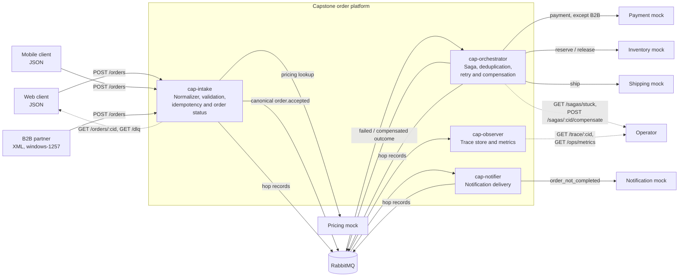
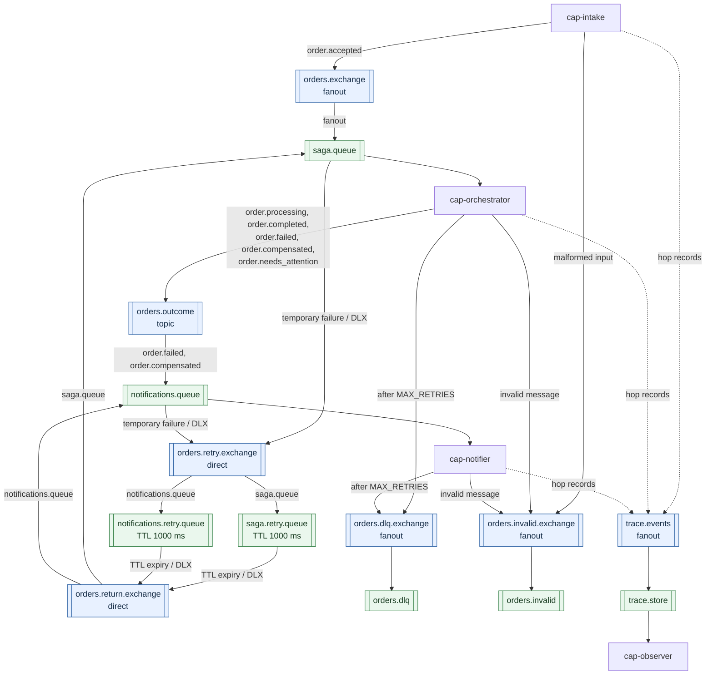

# Architecture

## System context

The capstone accepts orders from web clients, mobile clients and B2B partners. Intake normalizes the incoming payload, translates B2B XML where needed, enriches and validates the order, then publishes the canonical order. The orchestrator owns the order saga: it deduplicates by business key, skips payment for B2B orders, calls the payment, inventory and shipping mocks, and coordinates compensation when a step fails. Failed and compensated outcomes are sent to the notifier, which calls the notification mock. The observer stores trace hops and exposes trace and operational metrics.

## Integration architecture

The broker topology below follows README §3.2. All listed exchanges and queues are durable. The retry queues use a 1-second TTL and return messages to their original consumer queue through `orders.return.exchange`. Messages that exhaust retries go to the dead-letter exchange; malformed messages are quarantined on the invalid channel. The trace wire tap is separate from the business flow: publishing a hop is best-effort and does not block the operation.

### Message paths

- **Accepted order:** intake publishes a persistent, publisher-confirmed `order.accepted` event to `orders.exchange`; the fanout binding delivers it to `saga.queue`.
- **Saga retry:** a requeued saga message is dead-lettered to `orders.retry.exchange`, routed to `saga.retry.queue`, held for its 1-second TTL, then dead-lettered through `orders.return.exchange` back to `saga.queue`.
- **Notification retry:** the same TTL pattern uses `notifications.retry.queue` and returns only to `notifications.queue`.
- **Dead letter:** after the retry limit, the consumer publishes to `orders.dlq.exchange`; `orders.dlq` stores the message for operator inspection and replay.
- **Invalid message:** malformed input is published to `orders.invalid.exchange` and stored in `orders.invalid`, without entering the retry path.
- **Outcome notification:** `orders.outcome` is a topic exchange. `notifications.queue` is bound for `order.failed` and `order.compensated`; the notifier sends the `order_not_completed` notification.
- **Trace wire tap:** each service publishes hop records to `trace.events`; the fanout binding delivers them to `trace.store`, which the observer reads for `GET /trace/:cid` and `GET /ops/metrics`.

### Exchanges and queues

| Broker entity | Type | Purpose |
|---|---|---|
| `orders.exchange` | fanout exchange | Canonical accepted order event |
| `orders.retry.exchange` | direct exchange | Routes failed deliveries to the retry queue for their origin |
| `orders.return.exchange` | direct exchange | Returns expired retry messages to their origin queue |
| `orders.dlq.exchange` | fanout exchange | Dead-letter channel |
| `orders.invalid.exchange` | fanout exchange | Invalid-message quarantine channel |
| `orders.outcome` | topic exchange | Saga lifecycle and outcome events |
| `trace.events` | fanout exchange | Best-effort trace wire tap |
| `saga.queue` | queue | Orchestrator input |
| `saga.retry.queue` | queue, 1-second TTL | Saga retry delay |
| `notifications.queue` | queue | Notifier input |
| `notifications.retry.queue` | queue, 1-second TTL | Notification retry delay |
| `orders.dlq` | queue | Dead-letter messages |
| `orders.invalid` | queue | Quarantined invalid messages |
| `trace.store` | queue | Trace hops consumed by observer |
